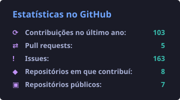
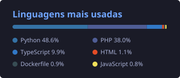

  

  

  
  

Sou dev de Teresina (PI).

Hoje trabalho na GW e na Unimed, mais no backend: APIs, integrações entre sistemas e muito SQL no Oracle. Antes passei uns bons anos fazendo de tudo um pouco (web, app, backend) e peguei gosto por entender o problema até o fim, inclusive conferindo no banco se o que eu fiz funcionou mesmo.

Também tô fazendo pós em Machine Learning Engineering na FIAP, então os projetos públicos mais recentes aqui são de lá.

Fora do código, sou viciada em One Piece. Pode puxar assunto 🏴‍☠️

## Onde trabalho / trabalhei

**GW** · Desenvolvedora Sênior

<!-- TODO: preencher com o resumo da GW -->
_(em breve)_

**Unimed** · Desenvolvedora Plena

Faço APIs que ligam o sistema de gestão da operadora com cobrança e com os apps e portais de beneficiários e cooperados. Uma das coisas mais legais que fiz lá foi migrar uma integração de cobrança que rodava num sistema legado para uma API nova, sem parar a operação. Também cuido das rotinas automáticas de envio e baixa de títulos, e de vez em quando caço consulta lenta no Oracle.

PHP 8, Laravel, Lumen, Oracle PL/SQL, PostgreSQL, Redis, Docker, GitLab CI, n8n

**Classetech** · Desenvolvedora de Aplicativos Móveis · abr/2024 a out/2026

Software house aqui de Teresina. Trabalhei principalmente no Classecon, um sistema de gestão de condomínios, onde fiz o portal web praticamente sozinha. Lá entreguei coisas como assembleia virtual com votação, controle de acesso da portaria e o fluxo de multa por infração ao regimento (esse deu trabalho, tinha regra pra todo lado). Também mexi nos apps em React Native/Expo, publiquei nas lojas, montei uma base white label pra gerar apps de marcas diferentes e integrei uma assistente de IA no WhatsApp com n8n.

React, TypeScript, React Native, Expo, PHP (CodeIgniter), Laravel, MySQL, AWS, n8n

## Projetos da pós (FIAP)

- [**tech-challenge-petr4-lstm**](https://github.com/SheylaSilvana/tech-challenge-petr4-lstm): LSTM pra prever o preço da PETR4, com API em FastAPI, Docker e monitoramento no Prometheus/Grafana.
- [**tech-challenge-bovespa-pipeline**](https://github.com/SheylaSilvana/tech-challenge-bovespa-pipeline): pipeline de dados da B3 na AWS (S3, Lambda, Glue e Athena).
- [**tech-challenge-flight-delays**](https://github.com/SheylaSilvana/tech-challenge-flight-delays): modelos pra prever atraso de voos nos EUA, com uns 5,8 milhões de registros.

## O que eu uso

  

  
  

